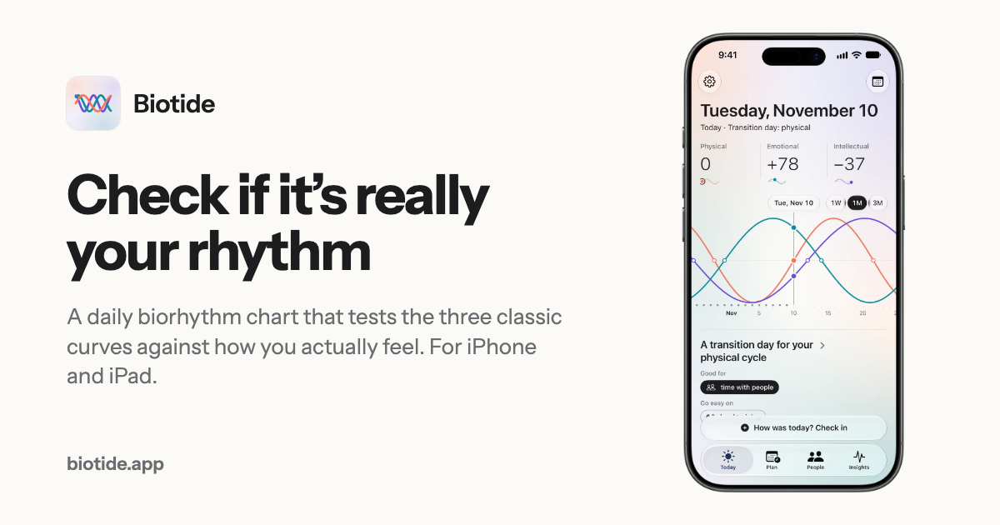
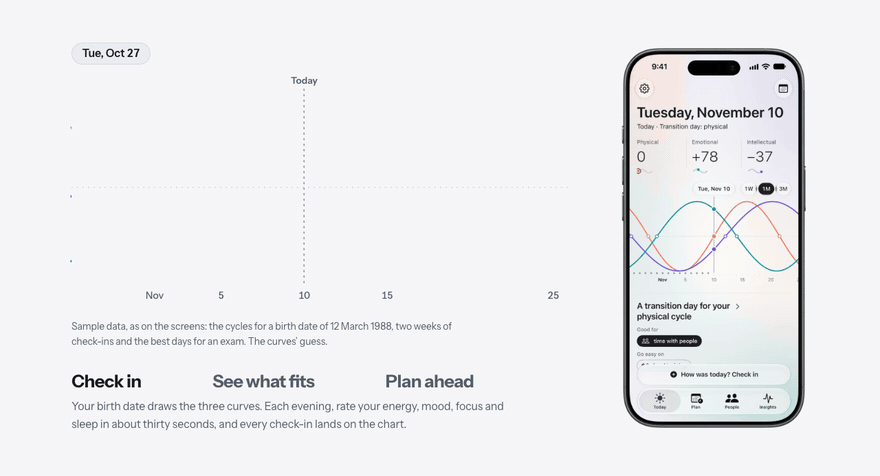
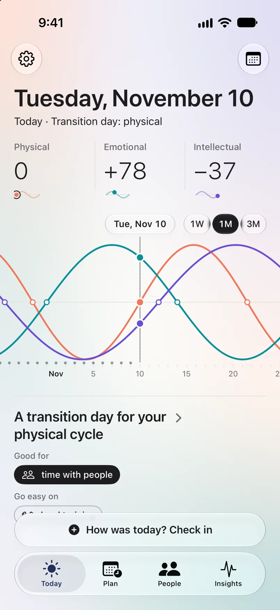
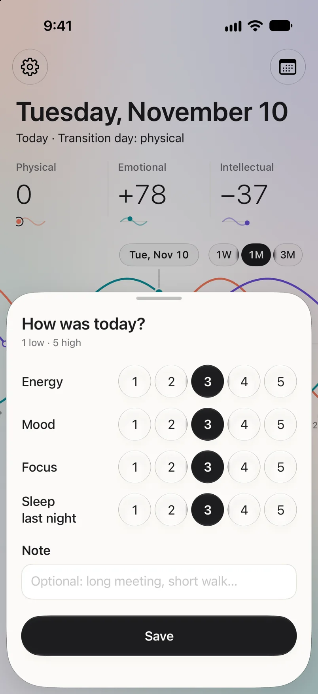
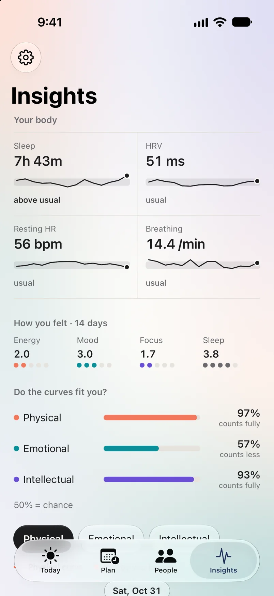
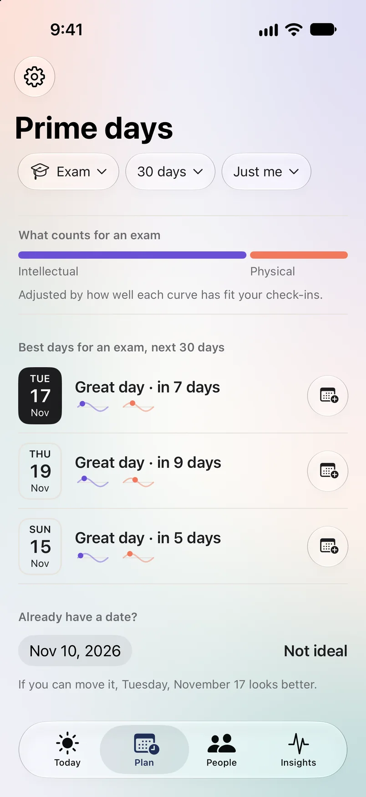
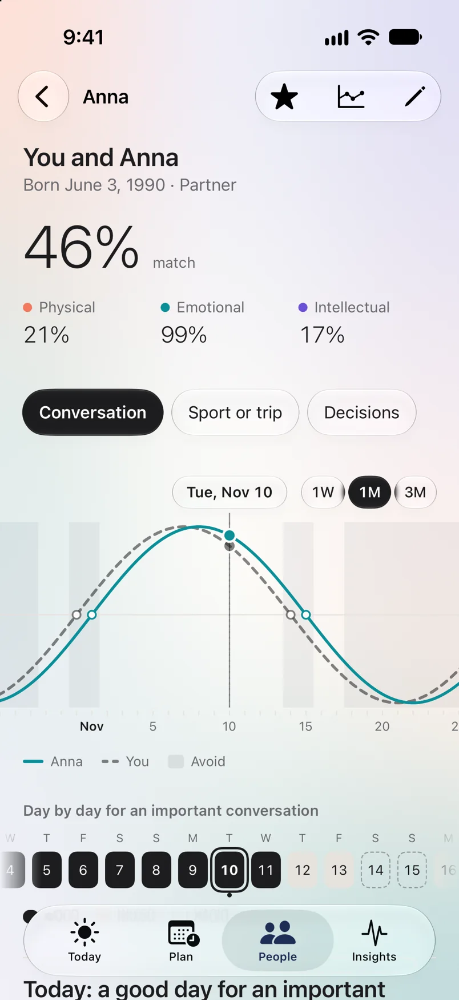
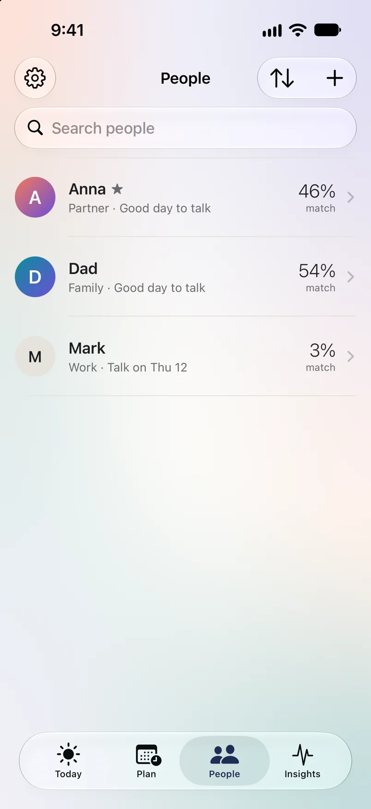

<p align="center">
  <a href="https://biotide.app"></a>
</p>

<p align="center">
  <a href="https://biotide.app"></a>
  
  
  
  
</p>

<h3 align="center">Most biorhythm apps tell you. Biotide asks you.</h3>

<p align="center">
  Three classic cycles from your birth date. A thirty-second check-in each evening.<br>
  After two weeks you see which curves are really yours, and only those shape your days.
</p>

## How it works

<p align="center">
  
</p>

<table>
  <tr>
    <td width="33%" valign="top"><b>1. Check in</b><br>Rate your energy, mood, focus and sleep each evening, in about thirty seconds.</td>
    <td width="33%" valign="top"><b>2. See what fits</b><br>After 14 check-ins, see how often each curve matched how you felt. A curve that doesn't fit counts for less.</td>
    <td width="33%" valign="top"><b>3. Plan ahead</b><br>Get the best days for an exam, an interview or an important conversation, alone or with someone.</td>
  </tr>
</table>

## Inside the app

<table>
  <tr>
    <td align="center" width="33%"><br><b>Today</b><br>Your three cycles and the day in words</td>
    <td align="center" width="33%"><br><b>Check-in</b><br>Five circles per question, thirty seconds</td>
    <td align="center" width="33%"><br><b>Insights</b><br>Which curves fit you, next to your body signals</td>
  </tr>
  <tr>
    <td align="center"><br><b>Prime days</b><br>The best days for what's coming up</td>
    <td align="center"><br><b>Compatibility</b><br>Your rhythm next to someone else's</td>
    <td align="center"><br><b>People</b><br>Everyone, with their next good day to talk</td>
  </tr>
</table>

## Features

- **Daily biorhythm chart**: physical, emotional and intellectual, drawn from your birth date. Drag through time, from a week to three months.
- **Your day in words**: what to lean into, what to go easy on, and transition days (the classic "critical days") marked ahead.
- **Is it really your rhythm?**: a daily check-in decides how much each curve counts in your readings and plans.
- **Prime days**: the best days in the next 30, 60 or 90 for nine kinds of events.
- **Biorhythm compatibility**: people from Contacts or by birthday, a match percentage and the next good day to talk.
- **Apple Health** (Plus): sleep, heart rate variability and resting heart rate against your own usual.
- **Widgets** for the Home Screen and the Lock Screen, **iCloud sync**, **English and Ukrainian**.

## Private by design

No account, no servers, no ads, no analytics in the app. Your data stays on your device, or in your own private iCloud if you turn on sync. Apple Health data is only read and never leaves the device. [Privacy policy](https://biotide.app/privacy.html).

## Availability

Coming soon to the App Store. Free to download, with an optional Biotide Plus. iPhone and iPad with iOS 26 or later.

<details>
<summary><b>About this repository</b></summary>
<br>

This is the source of [biotide.app](https://biotide.app): plain HTML, CSS and JavaScript with no build step, served by GitHub Pages from `main`.

```bash
python3 -m http.server 8000          # preview at http://localhost:8000
python3 scripts/check_seo.py         # titles, descriptions, schema, sitemap, llms.txt
python3 scripts/sync_chrome.py       # copy the header, consent banner and footer to every page
python3 scripts/html_to_md.py        # Markdown mirrors for AI agents (pip install beautifulsoup4 markdownify)
python3 tools/how_scene.py           # rebuild the "How it works" scroll scene from the app's sample data
tools/render_og.sh                   # render the social card with headless Chrome
```

| Path | What it is |
| --- | --- |
| `index.html`, `privacy.html`, `404.html` | The pages; `*.html.md` are their generated Markdown mirrors |
| `themes/default.css`, `styles.css` | Colour and type tokens, then layout |
| `landing.css`, `landing.js` | The homepage's scroll scene, on the scroll-craft engine (`scrollcraft.css`, `scrollcraft.js`) |
| `images/` | Real app screens from the app's screenshot mode, the app icon, Apple's iPhone 17 bezel, the social card |
| `llms.txt`, `robots.txt`, `sitemap.xml` | Search and AI-agent discovery |
| `scripts/`, `tools/` | The checks above, the page template and asset tools |

Credits: [Instrument Sans](https://github.com/Instrument/instrument-sans) (SIL Open Font License), the [scroll-craft](https://github.com/nateherkai/scroll-craft) engine by Nate Herk (MIT), and Apple's iPhone bezel from [Apple Design Resources](https://developer.apple.com/design/resources/).

</details>

<p align="center"><sub>© 2026 Biotide. All rights reserved.</sub></p>
